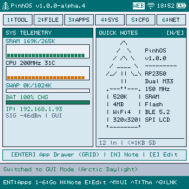
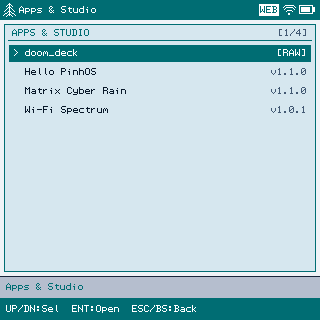
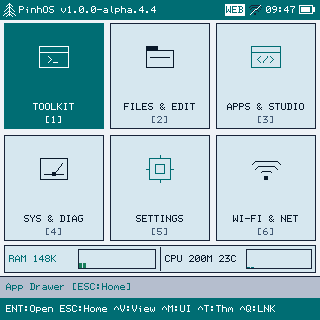

# 🌲 PinhOS

**A modular, dual-UI MicroPython operating system and portable field cyberdeck platform for the ClockworkPi PicoCalc & Raspberry Pi Pico 2W (RP2350).**

> 🚀 **Current Pre-Release: `v1.0.0-alpha.5.1`** — Phases 1–4.x + **Phase 5.1** (Theme Schema v2, selectable `6×8` fonts, `Obsidian Amber`, flicker-free partial `DesktopHome` telemetry & persistent sparklines, live `SHIFT` `F1`–`F5` ↔ `F6`–`F10` keybar + `[F1]` Help, `L/R` quick-strip, strict `COM4` `LNK` lock + popup, periodic RTC/NTP, Two-Stage Soft+Hard Watchdog & **MemGuard** SRAM reclaimer) complete & verified **12/12 Self-Test** on real PicoCalc (RP2350) hardware. Next up: SoftAP/Async Wi-Fi, Signed SHA-256 OTA & App Store.

| Desktop Home | App Drawer | Settings & Menus | System Telemetry |
| :---: | :---: | :---: | :---: |
|  |  |  |  |

*Real 320×320 on-device screenshots captured directly on the ClockworkPi PicoCalc via `CTRL+P`.*

---

## Key Features
* **Dual-UI & Theme Schema v2 (`ui/`, `themes/`):** Live `[F3]`/`[TAB]` switching between an Android-style Desktop Home (with `LEFT`/`RIGHT` quick-strip category navigation) / 3×2 GUI Mosaic and high-density TUI mode with zero full-screen Python framebuffers, 5 hot-swappable JSON themes (`[F2]`, including **Obsidian Amber**), selectable `570 B` `6x8` bitmap fonts (`default`, `bold`, `retro`, or `/sd/pinhos/fonts/*.bin`), configurable widget chrome, and `[CTRL+P]` 320×320 BMP screenshots.
* **Resilient RP2350 Kernel (`core/`, `main.py`):** 3-Strike Boot Guard with Safe Recovery & BSOD, Two-Stage Soft + Hard RP2350 Watchdog (`15s`/`30s`/`60s`/`OFF` + **"Not Responding"** Wait/Abort/Reboot dialog & `wdt.log` in `CTRL+L`), **MemGuard** idle/pre-flight SRAM reclaimer with lazy GUI/TUI backends, sandboxed `APP_META` app runner (`< 2 KB` SRAM delta), quota-managed SD `.swap/`, and 33-module pre-compiled `.mpy` (`-O2`, `v6.3`) core OS deployment.
* **Built-In Field Tooling (`tools/`):** BusyBox-style CLI shell, streaming text/JSON editor, SD & flash file commander, DNS/TCP/subnet/WoL network probes, HAL-routed `UART1` serial console, and live SRAM/CPU/SD benchmark monitor.
* **Hardened WebPortal Browser IDE (`web/`):** Non-blocking `uasyncio` HTTP/REST server + zero-dependency Browser IDE over Wi-Fi (live screen capture, virtual keyboard, SD explorer, code/theme editor, remote app launch) secured with fail-closed 16-hex `X-PinhOS-Token` auth, sensitive-file denylist, and 5-fail `429` lockout.
* **Wi-Fi, Persistent RTC & GitHub Sync (`net/`):** Multi-SSID CYW43439 STA manager with RX-pumped stability, automatic boot & periodic background NTP sync, periodic/sleep/reboot SD `rtc_state.json` retention, and direct GitHub theme/app sync.
* **Hardware Abstraction (`boards/`, `firmware/`):** Decoupled HAL for ClockworkPi PicoCalc & custom Pico 2W decks, paired with a custom auto-boot RP2350 UF2 (`[F1]` Recovery, `[F2]` Boot Menu, `[CTRL+C]` REPL).

---

## Architecture


<details>
<summary><b>📁 Repository Structure</b> (click to expand)</summary>

```text
pinhos/
├── main.py                  # Boot entry point, 3-strike guard, recovery, WDT & UI loop
├── version.json             # Semantic version, build metadata & OTA manifest
├── boards/                  # HAL (base.py, picocalc.py, generic_spi.py)
├── core/                    # Sandbox, SD swap, config, JSON theme engine, rotating logger
├── ui/                      # Dual-UI engine, 6x8 fonts, widgets, Desktop Home, Settings, GUI/TUI
├── net/                     # Wi-Fi STA/NTP manager, GitHub sync, OTA & BLE (Phases 5–6)
├── web/                     # Hardened uasyncio WebPortal REST server & zero-dep Browser IDE
├── tools/                   # BusyBox shell, editor, files, net_tools, uart_term, sysmon
├── apps/                    # User/community applets (single-entry APP_META contract)
├── themes/                  # Built-in JSON themes (cyber_amber, obsidian_amber, phosphor_green, arctic_daylight, synthwave_pulse)
├── tests/                   # 12/12 on-device self-test gate + Deep Stress suite
├── firmware/                # Custom RP2350 auto-boot UF2 builder & frozen early-boot router
├── docs/                    # Architecture diagram, screenshots, design specs, runbooks & release notes
├── scripts/                 # Release stamping & host helpers
└── picocalc.ps1             # Windows CLI for .mpy build, SD sync, selftest, stress & screenshots
```

</details>

---

## Quick Start (ClockworkPi PicoCalc / Pico 2W)

**Target Hardware:** Raspberry Pi Pico 2W (RP2350A, 520 KB SRAM, CYW43439 Wi-Fi/BLE) · 320×320 SPI IPS LCD · STM32 I2C QWERTY/Battery southbridge · FAT32 microSD.

1. **Flash the Base UF2 (one-time):** Hold **BOOTSEL**, connect USB, and copy `firmware/dist/pinhos-picocalc-pico2w.uf2` to the `RP2350` drive (or build in WSL2 via `bash firmware/build_uf2.sh`).
2. **Insert a FAT32 microSD card**, connect USB-C (`COM4`), and deploy from PowerShell:
   ```powershell
   .\picocalc.ps1 build            # Offline mpy-cross (-O2, v6.3) bytecode & JSON check
   .\picocalc.ps1 com              # Port & live REPL health check
   .\picocalc.ps1 upload_and_start # Incremental .mpy/SD sync + 5s Boot Guard launch
   .\picocalc.ps1 test             # 12/12 on-device self-test gate
   .\picocalc.ps1 stress           # Deep Stress Suite (Gates 13–14 + menu walk)
   .\picocalc.ps1 screenshot       # Capture & pull 320x320 BMP over COM4
   ```

<details>
<summary><b>⌨️ Cold-Boot, Standardized F1–F10 Keybar & Shortcuts</b> (click to expand)</summary>

**Cold-Boot Splash (5s countdown):** `ENTER` skip countdown · `F1`/`ESC` Safe Recovery · `F2` Dual-Boot Manager · `CTRL+C` MicroPython REPL (`COM4`)

**Desktop Home & App Drawer Function Keybar (`FooterBar`):**
* `F1` — Keyboard Help overlay (`ESC` / `ENTER` / `F1` to close)
* `F2` (`CTRL+T`) — Cycle active JSON theme live
* `F3` (`TAB` / `CTRL+M`) — Toggle `GUI` ↔ `TUI` rendering mode live (`CTRL+V` Grid/List)
* `F4` — Open 6-category Settings menu
* `F5` (`N`) — Quick inline note entry (`/sd/pinhos/notes.txt` `<= 1 KB`) · `ALT+F5` — Hard Reload UI (`x2` hardware reset)
* `Shift+F6` — Toggle WebPortal HTTP IDE server on/off
* `Shift+F7` (`CTRL+Q`) — Toggle non-blocking `COM4` Serial Link (`LNK`)
* `Shift+F8` — Pointer / Mouse mode hook (`Phase 6`)
* `Shift+F9` (`E`) — Open `/sd/pinhos/notes.txt` in `tools/editor.py`
* `Shift+F10` — Run 12/12 on-device self-test suite (`tests/selftest.py`)

**Navigation & Direct Tool Aliases:**
* `LEFT` / `RIGHT` — Cycle `DesktopHome` quick-category strip (`1:TOOL` .. `6:NET`, `ENTER` opens highlighted pill, `DOWN`/`ESC` unselects to App Drawer)
* `1`–`6` — Direct category jump · `ENTER` — Open App Drawer / selected item · `ESC` — Home / Back
* `CTRL+B` / `F` / `E` / `U` / `N` / `S` — Launch Shell, Files, Editor, UART, Net Probes, SysMon *(tools retain their own local `F`-key bindings)*
* `CTRL+P` — Save 320×320 BMP screenshot · `CTRL+L` — Log Viewer (`system.log`, `crash.log`, `wdt.log`, `web.log`) · `CTRL+Z` / `POWER` — Sleep Mode

**Host Scripts:** `picocalc.ps1` (build/deploy/test/stress/raw REPL) · `scripts/stamp_release.ps1` (version & tag stamping) · `scripts/pinhos_portal_relay.ps1` (local HTTP relay)

</details>

<details>
<summary><b>🎨 Theme Schema v2, Custom 6×8 Fonts & Banners</b> (click to expand)</summary>

Themes live in `/sd/pinhos/themes/*.json` (`<= 1 KB` atomic write limit) and deep-merge onto built-in defaults so minimal or legacy v1/flat JSON themes remain 100% compatible. `ThemeManager` pre-computes `RGB565` ints, a 16-entry `GS4_HMSB` LUT, and a cached `570 B` glyph `memoryview` on load (zero per-frame allocations).

* **Fonts (`"font"`):** Built-in `"default"`, `"bold"`, or `"retro"`, or drop a raw `570 B` (`95` ASCII chars `32..126` × `6` column bytes) glyph sheet at `/sd/pinhos/fonts/<name>.bin` (falls back to `"default"` if missing/invalid).
* **Widget Chrome (`"style"`):**
  * `"border_style"`: `"single"` | `"double"` | `"rounded"` | `"none"`
  * `"bar_style"`: `"blocks"` | `"solid"` | `"striped"`
  * `"card_header"`: `"filled"` | `"tinted"` | `"underline"`
  * `"quick_strip"`: `"pills"` | `"tabs"`
* **Headers & Banners:** `"uppercase_headers": true | false`, plus optional `"banner"` (`null`, inline string array, or `/sd/pinhos/banners/<name>.txt` clamped to the `DesktopHome` right pane).

```json
{
  "id": "obsidian_amber",
  "name": "Obsidian Amber",
  "version": 2,
  "font": "bold",
  "uppercase_headers": true,
  "colors": {
    "bg": "#090A0D", "surface": "#111318", "surface_alt": "#181B22",
    "header_bg": "#F59E0B", "header_fg": "#090A0D",
    "footer_bg": "#F59E0B", "footer_fg": "#090A0D",
    "text": "#F4F5F7", "text_muted": "#8E95A5",
    "accent": "#F59E0B", "accent_fg": "#090A0D",
    "sel_bg": "#F59E0B", "sel_fg": "#090A0D",
    "border": "#262B36", "border_focus": "#F59E0B",
    "ok": "#10B981", "warn": "#F59E0B", "err": "#EF4444"
  },
  "style": {
    "border_style": "single", "bar_style": "blocks",
    "card_header": "filled", "quick_strip": "pills"
  },
  "banner": null
}
```

</details>

---

## Roadmap

| Version | Milestone | Highlights |
| :--- | :--- | :--- |
| **`v1.0.0`** | **Foundation & Daily Driver** *(Active)* | HAL, Boot Guard, WDT, Sandbox/Swap, Dual-UI + Desktop Home, Themes, BusyBox Field Kit, Hardened WebPortal IDE *(Done)* → Signed SHA-256 OTA, App Store & BLE HID *(Next)* |
| **`v1.1.0`** | **Power & Native Performance** | Multi-UF2 SD chainloader (ARM + RISC-V) and dynamic C `.mpy` native modules (MP3/DSP/blits) |
| **`v1.2.0`** | **Commercial Packaging** | Frozen `.mpy` flash XIP firmware, RP2350 OTP/Secure Boot hardware-locked licensing & encrypted Pro Field Packs |
| **`v1.3.0`** | **Cloud WebPortal Relay & Identity** | Outbound `wss://` cloud relay (CGNAT-safe off-LAN access, `1 KB` binary BMP streaming), persistent `unique_id()` pairing & cloud license/entitlement sync |

See **[ROADMAP.md](./ROADMAP.md)** for full specs, memory budgets, and phase checklists.

---

## License & Policies

PinhOS is licensed under the **[PolyForm Noncommercial License 1.0.0](LICENSE)** (`SPDX-License-Identifier: PolyForm-Noncommercial-1.0.0`).

* **Free for:** Personal use, hobby projects, learning, experimentation, and non-commercial organizations.
* **Commercial use / resale:** Prohibited without a separate commercial license from the author (`bpinh0`).
* **Contributing & Security:** See [CONTRIBUTING.md](CONTRIBUTING.md) and [SECURITY.md](SECURITY.md).

`Required Notice: Copyright (c) 2026 Bruno Pinho (bpinh0) (https://github.com/bpinh0/PinhOS)`
