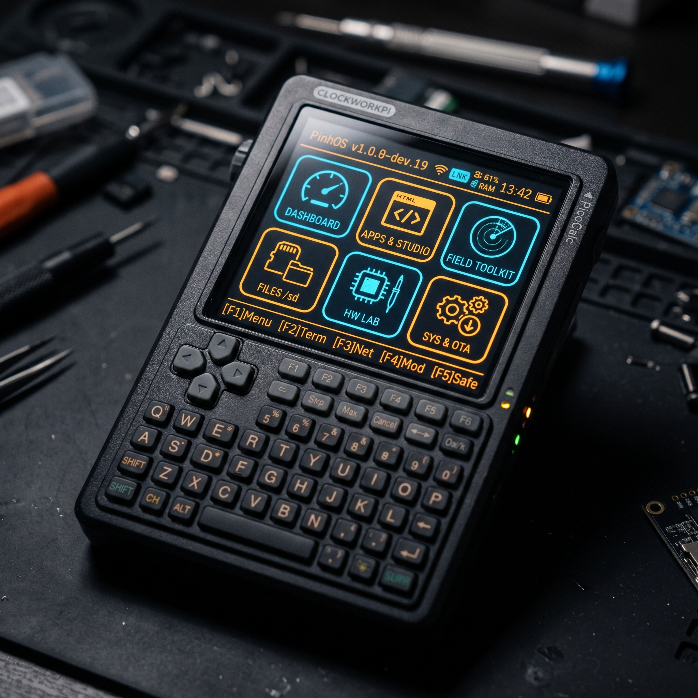
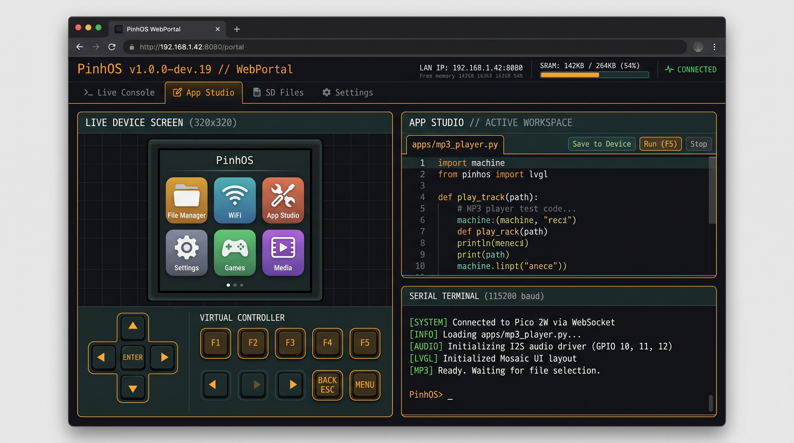
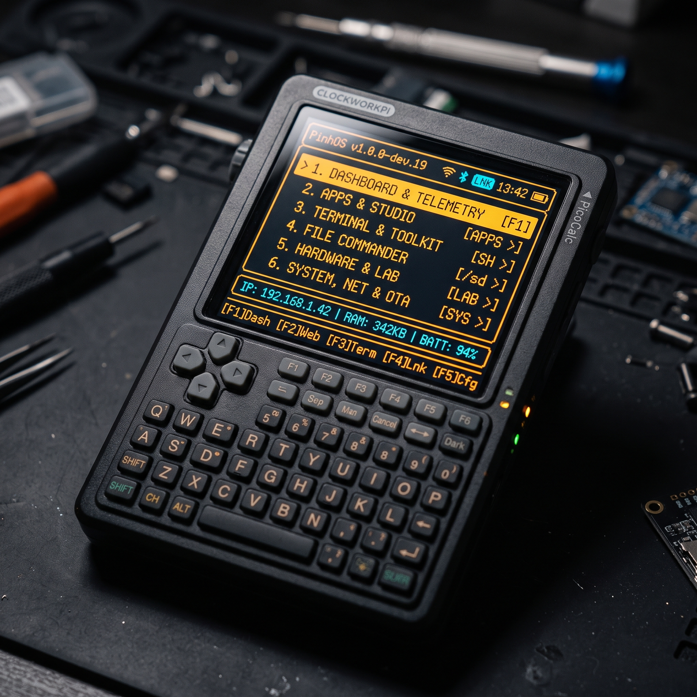
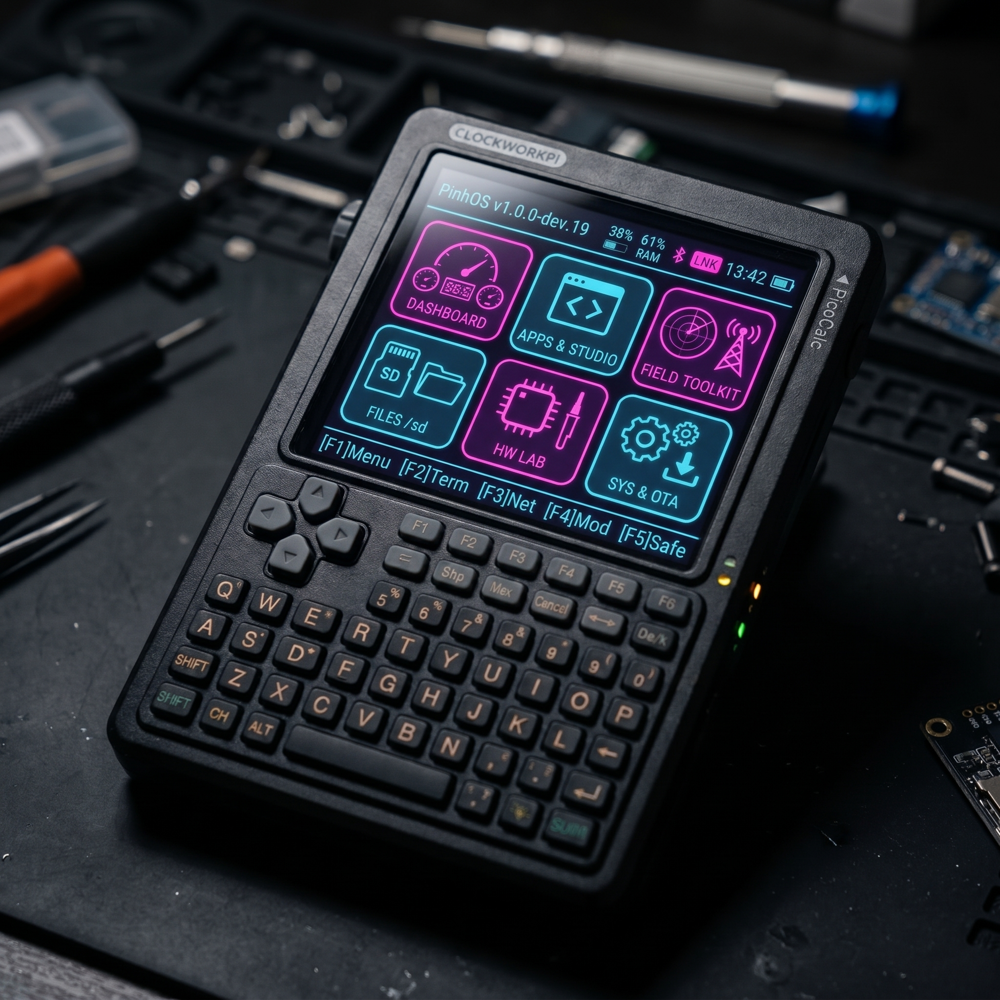

# ⚡ PinhOS

### **A Modular MicroPython Cyberdeck OS & Field Toolkit for the ClockworkPi PicoCalc**

*Turn your PicoCalc into a pocket-sized network & hardware cyberdeck—complete with a live browser WebPortal, isolated App Sandbox, BusyBox diagnostics, SD state-swapping, Desktop Mode, dual Native/LVGL graphics, and planned BLE peripheral support.*

## 🖼️ UI & WebPortal Previews

| Desktop Mode (`Cyber Amber`) | WebPortal Studio | 
| ----- | ----- | 
|  |  | 

| Native 16-Color LUT (`Cyber Amber`) | LVGL Mosaic Grid (`Synthwave Pulse`) | 
| ----- | ----- | 
|  |  | 

## 🚀 Why PinhOS?

Most microcontroller firmwares force a trade-off between raw scripting freedom and system stability. **PinhOS** is engineered from the ground up for the **RP2350 (520 KB SRAM)** to deliver real OS resilience without sacrificing hackability:

* 🛡️ **Crash-Proof Architecture:** Breadcrumb boot tracking, BSOD stack-trace forensics (`crash.log`), 3-strike automatic Safe Mode, and offline `.versions/` rollbacks ensure a bad script or theme never bricks your deck.

* 🧠 **Cooperative SD Memory Swap (`core/swap.py`):** Automatically spills cold buffers (logs, terminal scrollback, catalog caches) to `/sd/pinhos/.swap/` before launching heavy apps, LVGL, or BLE—freeing contiguous SRAM on demand while protecting SD flash wear.

* 🌐 **Live Theme-Synced WebPortal:** Control your PicoCalc from any desktop browser over Wi-Fi or USB serial with a real-time HTML5 `<canvas>` screen mirror, virtual D-Pad/F-Keys, SD file manager, and an online **App Studio** code editor.

* 📦 **Zero-Pollution App Sandbox:** Every app executes in a clean namespace with `sys.modules` snapshotting and automatic garbage collection on exit.

* 🎨 **Dual-Backend Graphics Engine & Unified JSON Themes:** Runs blazing-fast on the native **16-color RGB565 LUT** engine by default, with an optional **LVGL** backend toggle and **Desktop Mode** workspace that automatically fall back to Native LUT if firmware support or RAM is unavailable.

* ⌨️ **Future BLE 5.2 HID Host (Phase 6):** Pair external Bluetooth keyboards, mice, and gamepads directly to the Pico 2W's CYW43439 chip.

## ✨ Core Features & Cyberdeck Suite

### Six-Domain Main Deck

1. **📊 Dashboard & Telemetry (`F1`):** Real-time CPU load, `gc` SRAM free/used, SD Swap usage, Wi-Fi LAN IP/RSSI, and STM32 PMU battery cell voltage & runtime estimates.

2. **🧩 Apps & Developer Studio:**

   * **App Launcher & Git Store:** Standard `APP_META` manifests with `F5` metadata inspection and selective per-app GitHub downloads.

   * **On-Device & Browser Dev Studio:** Edit Python apps in your browser, upload via drag-and-drop, or hot-push over USB (`dev_watch.ps1`) and run immediately inside the isolated sandbox with live console streaming.

   * **Scratchpad Notes:** Lightweight Markdown/text notes synced between the PicoCalc and WebPortal.

3. **💻 Terminal & Cyberdeck Field Toolkit:**

   * **BusyBox-Style Shell:** Built-in `ping` (TCP RTT), `scan` (non-blocking TCP port scanner), `wol` (Wake-on-LAN magic packets), `nslookup`, `ifconfig`, `dmesg`, and `py` one-liner evaluator.

   * **Serial UART Console (`minicom` mode):** Connect directly to routers, switches, ESP32s, or headless servers via exposed `UART0`/`UART1` pins (`9600`–`921600` baud) with SD session logging.

   * **USB / SD Transfer Bridge:** Expose `/sd` over USB Mass Storage (firmware-dependent) or manage files wirelessly via the WebPortal REST API.

4. **📁 File Commander (`/sd`):** Full directory browser, custom extension-to-app associations (`Open With...`), `F5` file details, framebuffer `.bmp` screenshots (`F10`/`Ctrl+P`), and storage analyzer.

5. **🔧 Hardware & Diagnostics Lab:** Live GPIO/Pinout inspector (`IN`/`OUT`/`ADC`), I2C bus scanner, **PWM / Square-Wave Signal Generator** (`1 Hz`–`100 kHz`), crash forensics, and background RTC Pomodoro/Alarm timer.

6. **⚙️ System, Network & Git OTA:** Configurable `F1`–`F10` multi-page hotkeys, custom JSON themes (`LIST` & `MOSAIC` grids), optional Desktop Mode (with clean wake-to-home reset), screensaver, SemVer release channel selector (`STABLE` / `BETA` / `DEV`), 1-click version rollback, and BLE peripheral pairing.

## 🏗️ System Architecture

```
┌────────────────────────────────────────────────────────────────────┐
│  IMMUTABLE BOOTLOADER (.uf2 on RP2350 Flash)                       │
│  └─ Mounts /sd ──▶ Checks 3-Strike Breadcrumb ──▶ Boots /sd/pinhos │
└─────────────────────────────────┬──────────────────────────────────┘
                                  │
┌─────────────────────────────────▼──────────────────────────────────┐
│  LIVE OS PAYLOAD (/sd/pinhos/ — Updated via Git OTA or USB)        │
│                                                                    │
│  ├── main.py              # Safe-mode boot guard & reload loop     │
│  ├── version.json         # SemVer 2.0.0 metadata & changelog      │
│  ├── core/                                                         │
│  │   ├── kernel.py        # State machine, atomic I/O, BSOD        │
│  │   ├── input.py         # Unified matrix + Web + BLE HID input   │
│  │   ├── swap.py          # Cooperative SD state spill & SwapPager │
│  │   ├── sandbox.py       # Isolated app namespace & RAM cleanup   │
│  │   └── bridge.py        # <<PINHOS:...>> framed UART protocol    │
│  ├── ui/                                                           │
│  │   ├── renderer.py      # Native 16-color LUT & dirty-rect draw  │
│  │   ├── lvgl_backend.py  # Optional LVGL adapter + auto-fallback  │
│  │   ├── themes.py        # Unified LUT + LVGL JSON theme engine   │
│  │   └── desktop.py       # Optional icon & taskbar workspace      │
│  ├── themes/              # Starter JSON themes (Forest, Amber...) │
│  ├── net/                 # Wi-Fi, NTP, GitHub OTA & BLE HID Host  │
│  ├── web/                 # Non-blocking HTTP server & WebPortal   │
│  └── apps/                # Shell, Files, Store, Dev Studio, Lab   │
└────────────────────────────────────────────────────────────────────┘
```

## 🎨 Custom Theme Engine & Included Presets

PinhOS uses a **single-source JSON theme architecture** (`/sd/pinhos/themes/<theme_id>.json`) that compiles 12 semantic color tokens into Native 16-color RGB565 LUTs, LVGL `lv.style_t` containers, and WebPortal `:root` CSS variables simultaneously.

| Theme ID | Name | Palette Highlights | 
| ----- | ----- | ----- | 
| `black_forest` | **Black Forest** | Deep pine-charcoal `#080E0B`, forest emerald `#2ECC71`, warm birch gold `#D4A373` | 
| `cyber_amber` | **Cyber Amber** | Dark slate `#0A0C10`, phosphor amber `#FFB000`, electric cyan `#00E5FF` | 
| `phosphor_green` | **Phosphor Green** | Terminal black `#050A06`, classic P1 green `#33FF66`, lime accents | 
| `synthwave_pulse` | **Synthwave Pulse** | Midnight violet `#0D0618`, neon magenta `#FF2A85`, laser cyan `#00F0FF` | 
| `arctic_daylight` | **Arctic Daylight** | Crisp paper `#F4F7FA`, ink slate `#101820`, cobalt accent `#0066CC` | 

### Example Theme (`themes/black_forest.json`)

```json
{
  "id": "black_forest",
  "name": "Black Forest",
  "author": "bpinh0",
  "version": "1.0.0",
  "layout": "LIST",
  "font_scale": 1.0,
  "lvgl": { "card_radius": 8, "border_width": 2, "glow_alpha": 35 },
  "colors": {
    "bg": "#080E0B", "surface": "#0F1A14", "fg": "#2ECC71", "fg_muted": "#1D6F42",
    "accent": "#D4A373", "accent_fg": "#080E0B", "border": "#2ECC71",
    "sel_bg": "#1E5631", "sel_fg": "#E8F5E9", "ok": "#2ECC71", "warn": "#D4A373", "err": "#E74C3C"
  }
}
```

## 🛠️ Hardware Requirements & Quick Start

### Hardware

* **Device:** ClockworkPi PicoCalc

* **Compute Module:** Raspberry Pi Pico 2W (RP2350, Wi-Fi + BLE 5.2 CYW43439)

* **Storage:** FAT32 microSD card mounted at `/sd`

### Deploying via USB (`picocalc.ps1`)

Connect your PicoCalc to Windows over USB—`picocalc.ps1` automatically detects the RP2350 (`VID_2E8A`), checks whether the COM port is locked by another tool, and supports an optional `-Port` override:

```powershell
# Auto-detect PicoCalc COM port, verify availability, sync /sd/pinhos/, and reboot
.\picocalc.ps1 upload_and_start

# Optional: target a specific COM port manually
.\picocalc.ps1 upload_and_start -Port COM6

# Hot-push a single app file into the isolated sandbox
.\picocalc.ps1 hot_write .\apps\my_app.py /sd/pinhos/apps/my_app.py
```

### Accessing the WebPortal

1. Connect to Wi-Fi under **System, Network & OTA -> Network**.

2. Press **`F2`** (or open the Dashboard with **`F1`**) to view your assigned LAN URL (`http://<pico-ip>:8080`).

3. Open the URL in any browser for live screen mirroring, remote D-Pad/F-Key input, SD file transfers, and the browser-based **App Studio**.

## 🗺️ Roadmap & Release Channels

PinhOS follows strict **SemVer 2.0.0** pre-release channels targeting **`v1.0.0`**:

* `1.0.0-dev.<build>+<sha>` — Active development iterations

* `1.0.0-beta.<n>+<sha>` — Feature-complete public testing

* `1.0.0-rc.<n>+<sha>` — Release candidate freeze

* `1.0.0` — Official stable release

| Phase | Milestone | Status | 
| ----- | ----- | ----- | 
| **Phase 1** | Modular `/sd/pinhos/` architecture, 6-domain menu, `version.json`, sleep-wake home reset, smart COM discovery & core fixes | 🚧 In Progress | 
| **Phase 2** | GitHub OTA updater, local `.versions/` instant rollback & bootloader `.uf2` scripts | 📋 Planned | 
| **Phase 3** | Theme-synced WebPortal, App Developer Studio & `F5` file associations | 📋 Planned | 
| **Phase 4** | Dual-backend UI (`NATIVE LUT` + optional `LVGL` with auto-fallback) & Desktop Mode | 📋 Planned | 
| **Phase 5** | Cyberdeck Field Toolkit (UART `minicom`, Port Scanner, WoL, PWM gen, USB/SD bridge) | 📋 Planned | 
| **Phase 6** | Bluetooth BLE 5.2 HID peripheral support (keyboards, mice & gamepads via `net/ble.py`) | 📋 Planned | 

Full engineering specifications live in [`ROADMAP.md`](ROADMAP.md).

## 🤝 Contributing & Building Apps

Want to write an app for PinhOS? Drop a `.py` file into `/sd/pinhos/apps/` with a standard `APP_META` header:

```python
APP_META = {
    "name": "Hello Cyberdeck",
    "version": "1.0.0",
    "author": "YourName",
    "desc": "Minimal sandboxed PinhOS app",
    "ext": []
}

import picocalc, time

d = picocalc.display
d.fill(0)
d.text("HELLO PINHOS!", 95, 150, 10)
d.show()

while True:
    if picocalc.keyboard.read() == "\x1b":  # ESC exits cleanly back to PinhOS
        break
    time.sleep_ms(20)
```

## 📄 License

Released under the [MIT License](LICENSE). Built for the ClockworkPi & RP2350 maker community.