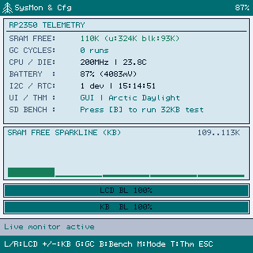

# 🌲 PinhOS

**A modular, dual-UI MicroPython operating system and portable field cyberdeck platform for the ClockworkPi PicoCalc & Raspberry Pi Pico 2W (RP2350).**

> 🚀 **Current Pre-Release: `v1.0.0-alpha.4.4`** — Phases 1–4.x complete & verified **12/12 Self-Test + Deep Stress** on real PicoCalc (RP2350) hardware (`~220–240 KB` free SRAM / `96 KB` contiguous block on boot). **Phase 5** (Async Wi-Fi/SoftAP, Signed SHA-256 OTA & App Store) is next.

| Desktop Home | App Drawer | Settings & Menus | System Telemetry |
| :---: | :---: | :---: | :---: |
|  |  |  |  |

*Real 320×320 on-device screenshots captured directly on the ClockworkPi PicoCalc via `CTRL+P`.*

---

## Key Features
* **Dual-UI & Unified Theme Engine (`ui/`, `themes/`):** Live `[TAB]` switching between an Android-style Desktop Home / 3×2 GUI Mosaic and high-density TUI mode with zero full-screen Python framebuffers, 4 hot-swappable JSON themes (`[CTRL+T]`), and `[CTRL+P]` 320×320 BMP screenshots.
* **Resilient RP2350 Kernel (`core/`, `main.py`):** 3-Strike Boot Guard with Safe Recovery & BSOD, configurable RP2350 Hardware Watchdog (`wdt.log`), sandboxed `APP_META` app runner (`< 2 KB` SRAM delta), quota-managed SD `.swap/`, and pre-compiled `.mpy` (`-O2`) core OS deployment.
* **Built-In Field Tooling (`tools/`):** BusyBox-style CLI shell, streaming text/JSON editor, SD & flash file commander, DNS/TCP/subnet/WoL network probes, HAL-routed `UART1` serial console, and live SRAM/CPU/SD benchmark monitor.
* **Hardened WebPortal Browser IDE (`web/`):** Non-blocking `uasyncio` HTTP/REST server + zero-dependency Browser IDE over Wi-Fi (live screen capture, virtual keyboard, SD explorer, code/theme editor, remote app launch) secured with fail-closed 16-hex `X-PinhOS-Token` auth, sensitive-file denylist, and 5-fail `429` lockout.
* **Wi-Fi, Persistent RTC & GitHub Sync (`net/`):** Multi-SSID CYW43439 STA manager with RX-pumped stability, background NTP + SD RTC retention, and direct GitHub theme/app sync.
* **Hardware Abstraction (`boards/`, `firmware/`):** Decoupled HAL for ClockworkPi PicoCalc & custom Pico 2W decks, paired with a custom auto-boot RP2350 UF2 (`[F1]` Recovery, `[F2]` Boot Menu, `[CTRL+C]` REPL).

---

## Architecture


<details>
<summary><b>📁 Repository Structure</b> (click to expand)</summary>

```text
pinhos/
├── main.py                  # Boot entry point, 3-strike guard, recovery, WDT & UI loop
├── version.json             # Semantic version, build metadata & OTA manifest
├── boards/                  # HAL (base.py, picocalc.py, generic_spi.py)
├── core/                    # Sandbox, SD swap, config, JSON theme engine, rotating logger
├── ui/                      # Dual-UI engine, widgets, Desktop Home, Settings tree, GUI/TUI
├── net/                     # Wi-Fi STA/NTP manager, GitHub sync, OTA & BLE (Phases 5–6)
├── web/                     # Hardened uasyncio WebPortal REST server & zero-dep Browser IDE
├── tools/                   # BusyBox shell, editor, files, net_tools, uart_term, sysmon
├── apps/                    # User/community applets (single-entry APP_META contract)
├── themes/                  # Built-in JSON themes (cyber_amber, phosphor_green, arctic_daylight, synthwave_pulse)
├── tests/                   # 12/12 on-device self-test gate + Deep Stress suite
├── firmware/                # Custom RP2350 auto-boot UF2 builder & frozen early-boot router
├── docs/                    # Architecture diagram, screenshots, design specs, runbooks & release notes
├── scripts/                 # Release stamping & host helpers
└── picocalc.ps1             # Windows CLI for .mpy build, SD sync, selftest, stress & screenshots
```

</details>

---

## Quick Start (ClockworkPi PicoCalc / Pico 2W)

**Target Hardware:** Raspberry Pi Pico 2W (RP2350A, 520 KB SRAM, CYW43439 Wi-Fi/BLE) · 320×320 SPI IPS LCD · STM32 I2C QWERTY/Battery southbridge · FAT32 microSD.

1. **Flash the Base UF2 (one-time):** Hold **BOOTSEL**, connect USB, and copy `firmware/dist/pinhos-picocalc-pico2w.uf2` to the `RP2350` drive (or build in WSL2 via `bash firmware/build_uf2.sh`).
2. **Insert a FAT32 microSD card**, connect USB-C (`COM4`), and deploy from PowerShell:
   ```powershell
   .\picocalc.ps1 com              # Port & live REPL health check
   .\picocalc.ps1 upload_and_start # Incremental .mpy/SD sync + 5s Boot Guard launch
   .\picocalc.ps1 test             # 12/12 on-device self-test gate
   .\picocalc.ps1 stress           # Deep Stress Suite (Gates 13–14 + menu walk)
   .\picocalc.ps1 screenshot       # Capture & pull 320x320 BMP over COM4
   ```

<details>
<summary><b>⌨️ Cold-Boot & Live Hotkeys + Host Scripts</b> (click to expand)</summary>

**Cold-Boot Splash (5s countdown):** `ENTER` skip countdown · `F1`/`ESC` Safe Recovery · `F2` Dual-Boot Manager · `CTRL+C` MicroPython REPL (`COM4`)

**Live Dashboard Hotkeys:**
* `TAB` / `CTRL+M` — Toggle GUI ↔ TUI mode (`CTRL+V` Grid/List)
* `CTRL+T` — Cycle JSON themes · `CTRL+P` — Save 320×320 BMP screenshot
* `CTRL+B` / `F` / `E` / `U` / `N` / `S` — Launch Shell, Files, Editor, UART, Net Probes, SysMon
* `CTRL+L` — Log Viewer (`system.log`, `crash.log`, `web.log`, `wdt.log`)
* `CTRL+Q` — Toggle `COM4` Serial Link (`LNK`) · `CTRL+Z` / `POWER` — Sleep Mode
* `F2` — Run 12/12 self-tests · `ALT+F5` — Hard Reload UI (`x2` hardware reset)

**Host Scripts:** `picocalc.ps1` (build/deploy/test/stress/raw REPL) · `scripts/stamp_release.ps1` (version & tag stamping) · `scripts/pinhos_portal_relay.ps1` (local HTTP relay)

</details>

---

## Roadmap

| Version | Milestone | Highlights |
| :--- | :--- | :--- |
| **`v1.0.0`** | **Foundation & Daily Driver** *(Active)* | HAL, Boot Guard, WDT, Sandbox/Swap, Dual-UI + Desktop Home, Themes, BusyBox Field Kit, Hardened WebPortal IDE *(Done)* → Signed SHA-256 OTA, App Store & BLE HID *(Next)* |
| **`v1.1.0`** | **Power & Native Performance** | Multi-UF2 SD chainloader (ARM + RISC-V) and dynamic C `.mpy` native modules (MP3/DSP/blits) |
| **`v1.2.0`** | **Commercial Packaging** | Frozen `.mpy` flash XIP firmware, RP2350 OTP/Secure Boot hardware-locked licensing & encrypted Pro Field Packs |
| **`v1.3.0`** | **Cloud WebPortal Relay & Identity** | Outbound `wss://` cloud relay (CGNAT-safe off-LAN access, `1 KB` binary BMP streaming), persistent `unique_id()` pairing & cloud license/entitlement sync |

See **[ROADMAP.md](./ROADMAP.md)** for full specs, memory budgets, and phase checklists.

---

## License & Policies

PinhOS is licensed under the **[PolyForm Noncommercial License 1.0.0](LICENSE)** (`SPDX-License-Identifier: PolyForm-Noncommercial-1.0.0`).

* **Free for:** Personal use, hobby projects, learning, experimentation, and non-commercial organizations.
* **Commercial use / resale:** Prohibited without a separate commercial license from the author (`bpinh0`).
* **Contributing & Security:** See [CONTRIBUTING.md](CONTRIBUTING.md) and [SECURITY.md](SECURITY.md).

`Required Notice: Copyright (c) 2026 Bruno Pinho (bpinh0) (https://github.com/bpinh0/PinhOS)`
